# Astro-Amriit — User Guide

*For version 0.8. Written for astrologers, not for computer people.*

> Screenshots are from version 0.7; the new v0.8 pages (Page 1 (Experimental) and Matching) are described in text and will get pictures in a later update.

Every screenshot in this guide uses one public example chart: **Amitabh
Bachchan, 11 October 1942, 16:00, Allahabad (Prayagraj)**. You can cast the
same chart and compare it with the pictures.

**Contents**

1. [What Astro-Amriit is](#1-what-astro-amriit-is)
2. [Opening the app](#2-opening-the-app)
3. [Casting a chart](#3-casting-a-chart)
4. [The pages, one by one](#4-the-pages-one-by-one)
   - [4.1 Page 1](#41-page-1)
   - [4.2 Strengths](#42-strengths)
   - [4.3 Vargas](#43-vargas)
   - [4.4 Dashas](#44-dashas)
   - [4.5 KP (Research)](#45-kp-research)
   - [4.6 NTP (Research)](#46-ntp-research)
   - [4.7 Yogi & Bhava](#47-yogi--bhava)
   - [4.8 Jaimini](#48-jaimini)
   - [4.9 Transits](#49-transits)
   - [4.10 Page 1 (Experimental)](#410-page-1-experimental)
   - [4.11 Matching](#411-matching)
5. [Settings](#5-settings)
6. [How far can I trust each number?](#6-how-far-can-i-trust-each-number)
7. [Troubleshooting](#7-troubleshooting)
8. [Glossary](#8-glossary)

---

## 1. What Astro-Amriit is

Astro-Amriit (Karar Ashram Astrology Software) calculates Vedic charts the
way **Parashara's Light 9** (PL) does, and shows them in the East Indian
style the family knows from Kala Chakra. It gives the planets, the divisional
charts, the strengths, the dashas, Yogi points, bhava chalit, Jaimini points
and transits. Every number has been compared with PL's own output wherever
we had that output. Section 6 lists what has been checked and what has not.

**What it is not:** it does not write any interpretation. There are no
predictions, no "readings" and no text about what a placement means. It is a
calculating instrument. The judgement is yours.

---

## 2. Opening the app

### The single file (nothing to install)

Astro-Amriit is **one file** that ends in `.html`. Its name starts with
`Astro-Amriit` and includes a version number, for example
`Astro-Amriit v0.7.html`.

1. Copy the file to your computer (for example to the Desktop).
2. **Double-click** it. It opens in your web browser (Chrome, Edge, Firefox or
   Safari).
3. Wait for the green dot and the word **ready** at the top right. This takes
   about one second.

It needs **no internet**. Nothing is sent anywhere and nothing is downloaded.
The Swiss Ephemeris (the planetary tables) is built into the file itself.

When the app opens, it casts a chart for **this moment** at the last place you
used, so you never see an empty page. The chart form stays open at the top so
that you can type your own chart.

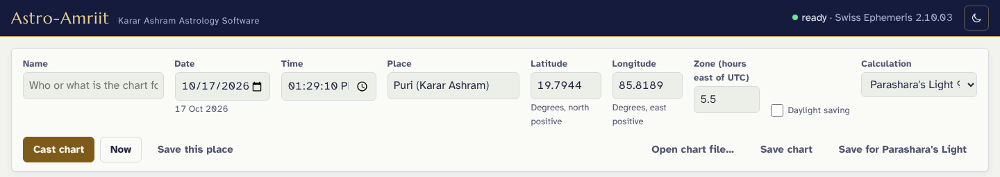

At the very bottom of every page is a small line such as
`Astro-Amriit v0.7.0 · single build …`. This is the version. Quote it if you
report a problem.

### The desktop installers (Windows and Mac)

For computers that should have the app in the Start menu or the
Applications folder, there is a Windows installer and a Mac disk image. They
contain the same app and also work with no internet. The step-by-step guide
for installing them from a USB stick is here:
[USB install guide](../install/USB_INSTALL_GUIDE.md).

In the desktop app, **Save chart** and **Save for Parashara's Light** put
the file straight into your **Downloads** folder and say *"Saved to your
Downloads folder."*

---

## 3. Casting a chart

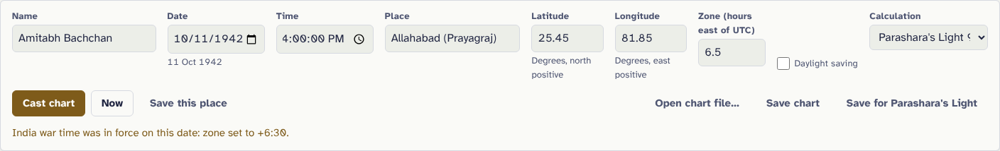

### The fields

| On screen | What to enter |
|---|---|
| **Name** | Who or what the chart is for. Optional. It appears in the centre of the Rasi chart and in file names. |
| **Date** | The date of birth or of the question. Years 1800 to 2399. |
| **Time** | Three boxes — **Hours**, **Minutes**, **Seconds** — on the 24-hour clock (4 pm is `16`). Typing two digits moves you to the next box, so on a phone you can simply type `160037` for 16:00:37. You may also type or paste a whole time such as `16:00:37` into **Hours**. (The phone's own time picker is not used, because on iPhone it has no seconds.) |
| **Place** | Start typing; a list of places appears: your saved places and the built-in ones first, then the **world atlas** (from version 0.10). Choose one with the mouse, or with ↓ and **Enter**. It fills **Latitude**, **Longitude**, **Zone** and **Daylight saving**. See [The world atlas](#the-world-atlas). |
| **Latitude** | Decimal degrees (`21.7033`, south negative) **or** degrees, minutes and seconds (`21 42 12 N`, `21°42′12″N`). Between −66.5 and 66.5. |
| **Longitude** | Decimal degrees (`84.0314`, west negative) **or** degrees, minutes and seconds (`84 01 53 E`). |
| **Zone (hours east of UTC)** | The time zone of the clock time you typed. India is `5.5`. |
| **Daylight saving** | Tick this if the clock was one hour ahead for summer time (or war time, see below). |
| **Calculation** | The calculation profile: **Parashara's Light 9** (the default), **Parashara's Light 7**, or **Solar Fire / Kala Chakra**. |

Latitude and longitude are in **decimal degrees**. For example 25°27′ N is
`25.45`.

### The date echo — always read it

Under the **Date** box the app writes the date in words, for example
**11 Oct 1942**. The date box itself shows the date in the order your
computer is set to: on many computers that is month/day/year
(`10/11/1942`). The words underneath cannot be misread. **Always check the
words before you cast.** Day and month swaps are the most common mistake in
hand-written birth data.

### The world atlas

From version 0.10 the app carries an atlas of about **86 000 places**, with no
internet needed:

- every town and city of **5 000 people or more**, worldwide;
- every Indian place for which a population is known;
- **every village in Odisha** (the source has no population for most villages,
  so a population rule would have left them out).

Type at least two letters. The list shows each place with its state (or
region), country and coordinates, so places with the same name can be told
apart: there are two Lapangas, one in Odisha and one in Jharkhand. Larger
places come first. Accents do not matter (`Bhubaneswar` finds *Bhubanēśvar*).

- **Old names work.** `Bombay`, `Calcutta`, `Madras`, `Bangalore`,
  `Allahabad`, `Benares`, `Poona`, `Baroda`, `Trivandrum` … find the city
  under its present name; the list shows the old name in brackets, as in
  *Mumbai (Bombay)*.
- **Narrow with a comma.** `Puri, Odisha` or `London, Canada` keeps only
  places in that state or country.
- The chosen place is written as *Name, State, Country*, for example
  *Sambalpur, Odisha, India*.

The atlas is built from **GeoNames** (geonames.org), licensed CC BY 4.0;
the credit is on the Settings page and at the foot of every page.

### The zone and India's war time

When you choose a place, the zone is filled in for you. For India between
**1 September 1942 and 14 October 1945** the clocks ran one hour ahead
("war time"). For these dates the app sets the zone to **+6:30** by itself
and shows this note in the form:

> India war time was in force on this date: zone set to +6:30.

This happens for the built-in Indian places and, from version 0.3, for
places you saved yourself that lie inside India. If you type latitude,
longitude and zone by hand without choosing a place from the list, the app
cannot tell, so set the zone yourself (see [Troubleshooting](#7-troubleshooting)).

**Places outside India** (atlas places, and from version 0.11 the built-in
London, New York and Singapore). The zone and daylight saving are
taken from the **world time-zone database** that every browser carries, for
the date and time in the form: New York on 1 July 1950 gives zone `-5` with
**Daylight saving** ticked, on 1 December 1950 `-5` without it. Britain's
war-time double summer time, occupied Singapore's Tokyo time and other
historical clocks come out the same way. A note under the form names the
zone used (for example *America/New_York*). Change the date or time and the
zone follows.

The database is very reliable from 1970 onwards. **For earlier dates, check
old charts against the birth record**: some countries' early local records
differ, and the note says so.

**Indian places** do not use the database's history for India. It follows
Calcutta's clocks: local mean time before 1906, and +6:30 also from October
1941 to May 1942. Indian places keep the rule above (IST, and war time from 1
September 1942 to 14 October 1945), which is what Parashara's Light does and
what the app's checks against PL 9 confirm.

There are two ways to write war time, and both give the same moment:

- Zone `6.5`, **Daylight saving** not ticked (what the app does when you
  choose a place), or
- Zone `5.5`, **Daylight saving** ticked (how Parashara's Light stores it in
  its chart files).

### The buttons

| Button | What it does |
|---|---|
| **Cast chart** | Calculates the chart from the form. The form then folds away. |
| **Now** | Casts a chart for this very moment at the place in the form (or the last place you used). Use it for horary (prashna) questions. |
| **Save this place** | Adds the place, with its latitude, longitude and zone, to your own list. It then appears when you type in **Place**. The app says **Place saved**. Up to 100 places are kept. |
| **Open chart file…** | Opens a chart file: a Parashara's Light `.xml` file or an Astro-Amriit chart file. The chart is cast at once. |
| **Save chart** | Saves the chart as an Astro-Amriit chart file (`name.astro-amriit.json`). |
| **Save for Parashara's Light** | Saves the chart as a PL chart file (`name.xml`) that PL can open. |
| **Edit chart** | Appears after casting, at the right of the chart's name. It opens the form again with the chart's data in it. |

Your saved places and the last place you used are remembered **by this
browser on this computer**. A different browser, or the desktop app, keeps
its own list.

### If something is wrong in the form

If a field is wrong, a red message appears **under that field** and nothing
you typed is lost. Correct the field and press **Cast chart** again.

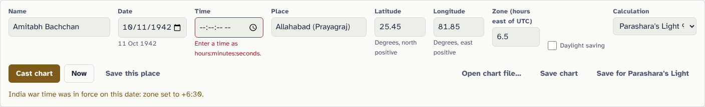

The messages are:

- *Enter a date between 1800 and 2399.*
- *Enter a time as hours:minutes:seconds.*
- *Latitude must be between −66.5 and 66.5 (houses are undefined near the poles).*
- *Longitude must be between −180 and 180.*
- *Zone must be between −14 and 14 hours.*

### Opening Parashara's Light chart files

PL keeps every chart as a small `.xml` file. Astro-Amriit opens these
directly.

1. Press **Edit chart** if the form is folded away.
2. Press **Open chart file…** and choose the `.xml` file.
3. The chart is cast at once, with the name, date, time and place from the
   file. The place appears as "City, Country".

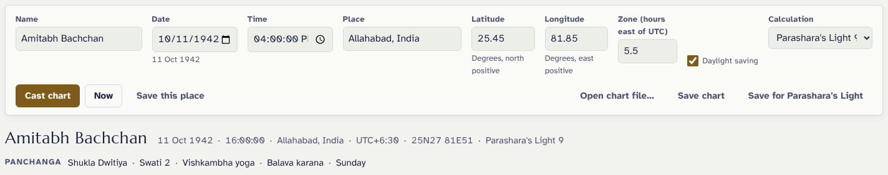

Points to know:

- The chart is cast with the **Calculation** profile that was selected in
  the form when you opened the file.
- PL files written in either of PL's two text formats open. Every file in
  the family's PL collection (over 1,500 files) has been opened in testing.
- Files saved by earlier test versions of this app (called *KAAST 2*) also
  open.
- A PL file can hold further charts for the same person, called *events*
  (for example "Today" or a muhurta). After opening the file, press **Edit
  chart**: they are listed under **This file also holds:** as buttons; press
  one to cast that chart. (In version 0.2 this list did not appear; fixed in
  version 0.3.)
- **Save for Parashara's Light** writes only the main chart, not events.

If the file is not a PL chart file, the app says *This is not a Parashara's
Light chart file (no <BirthData>).*

### The chart line

After casting, a line under the chart's name repeats the date, time, place,
zone (for example **UTC+6:30**), latitude and longitude (**25N27 81E51**) and
the profile. Below it is the **Panchanga** line: tithi with paksha, the Moon's
nakshatra and pada, yoga, karana and weekday. The weekday changes at
sunrise, as in PL; a birth before sunrise shows *(before sunrise)* after the
weekday.

---

## 4. The pages, one by one

The tabs under the chart line are, in order: **Page 1**, **Page 1 (Experimental)**,
**Strengths**, **Vargas**, **Dashas**, **KP (Research)**, **NTP (Research)**, **Yogi & Bhava**, **Jaimini**,
**Transits**, **Matching** and **Settings**. Click a tab to open its page.

Some conventions apply everywhere:

- Planets are written with two letters: **As** (ascendant), **Su**, **Mo**,
  **Ma**, **Me**, **Ju**, **Ve**, **Sa**, **Ra**, **Ke**. Each has its own
  colour, but the letters are always shown, so colour is never needed to
  read the page.
- An **R** right after a planet means retrograde.
- Signs are written with two letters: **Ar Ta Ge Cn Le Vi Li Sc Sg Cp Aq Pi**.
- Longitudes are degrees:minutes:seconds **within the sign**, for example
  `Aq 01:56:52`.
- Hold the mouse over a short heading (for example **SB%**) to see its full
  meaning.

### 4.1 Page 1

Page 1 follows PL 9's "Birth chart" page, so each panel is where a PL user
expects it.

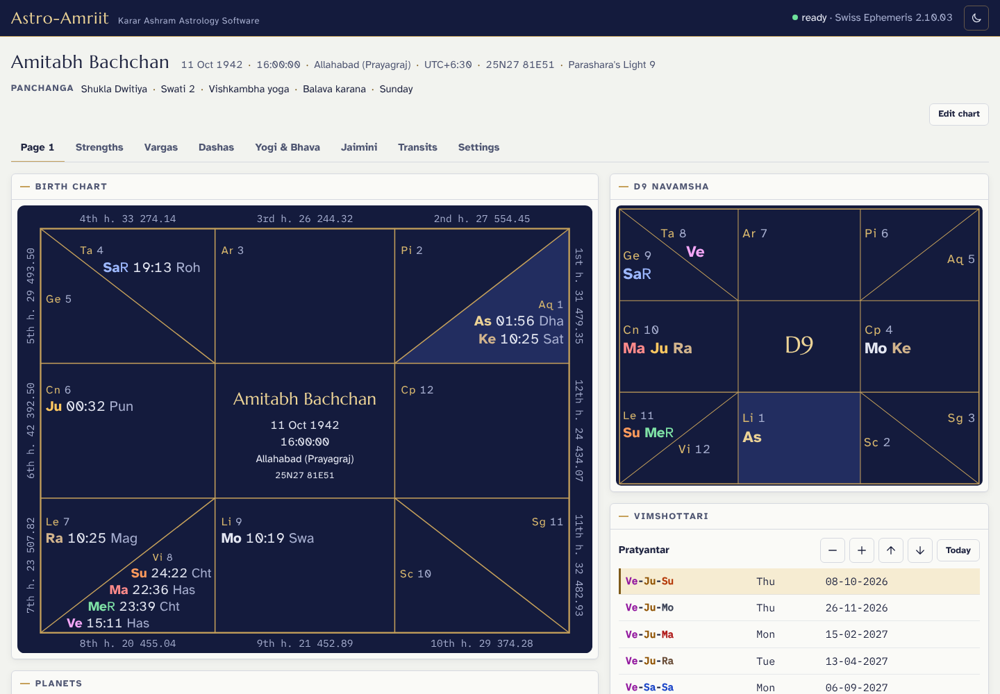

#### Birth chart (the Rasi chart)

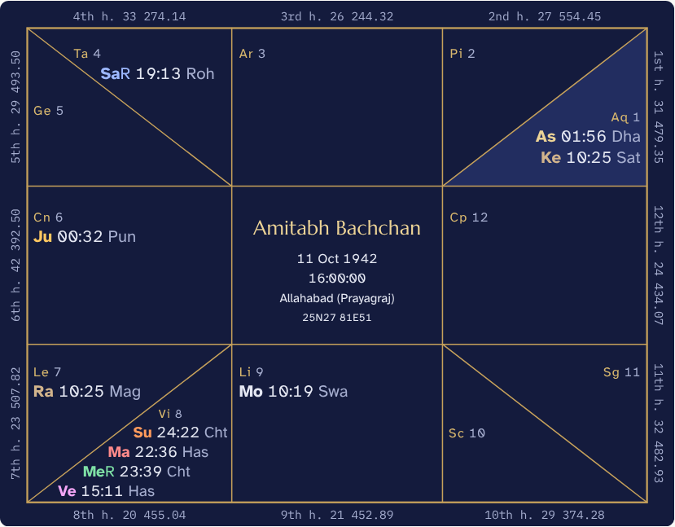

The chart is drawn in the **East Indian** style, exactly as Kala Chakra draws
it:

- **The signs do not move.** Aries is always at the top centre, and the signs
  run counter-clockwise: Taurus and Gemini in the top-left corner, Cancer on
  the left, and so on round to Pisces at the top right.
- Each sign's box starts with the **sign abbreviation** (for example **Aq**)
  and the **house number counted from the ascendant** (**Aq 1** means
  Aquarius is the 1st house).
- The **ascendant's box is tinted** a lighter blue.
- Each planet line reads, for example, **Ve 15:11 Has**: the planet, its
  degrees:minutes in the sign, and a three-letter nakshatra (Has = Hasta).
  An **R** after the planet (as in **MeR**) means retrograde.
- The centre holds the name, date, time, place and coordinates.

**The labels round the edge.** Each side of the chart carries labels such as
**1st h. 31 479.35**. As in PL, these are:

- **1st h.** — the house (whole sign: the sign beside the label);
- **31** — the **Sarvashtakavarga bindus** (SAV) of that house's sign;
- **479.35** — the **Bhava Bala** of that house, in virupas.

The twelve SAV numbers always add up to 337. The full tables behind both
numbers are on the **Strengths** page.

On a phone the chart shows only the planet names, without degrees and edge
labels, so that the text stays readable. The table below the chart has the
degrees.

#### D9 Navamsha

The navamsha chart, drawn in the same way. Each box shows the sign, the house
number from the navamsha ascendant, and the planets in that sign.

#### Planets

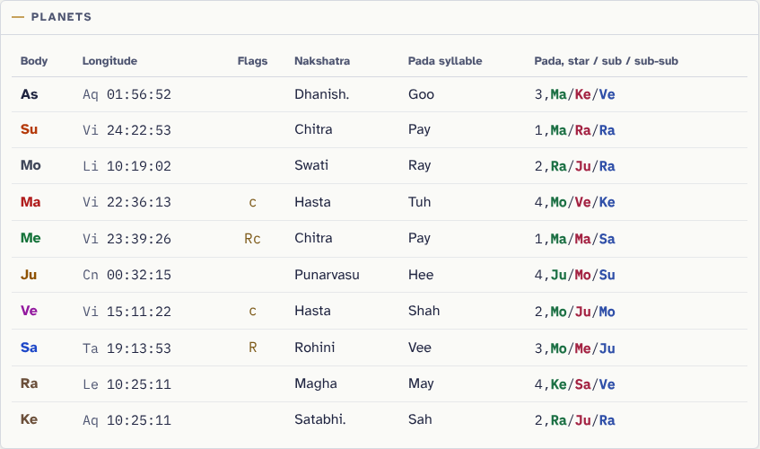

| Column | Meaning |
|---|---|
| **Body** | The planet (or **As** for the ascendant). |
| **Longitude** | Sign and degrees:minutes:seconds in the sign. Seconds are rounded, as PL 9 does. |
| **Flags** | **R** = retrograde, **c** = combust. **Rc** = both. |
| **Nakshatra** | The nakshatra, in PL's short spelling (for example *Dhanish.*, *Satabhi.*). |
| **Pada syllable** | The sound of the pada (nama nakshatra syllable), as PL lists it. |
| **Pada, star / sub / sub-sub** | The pada number, then the KP star lord (green), sub lord (red) and sub-sub lord (blue). Example: **3,Ma/Ke/Ve**. |

#### Strengths

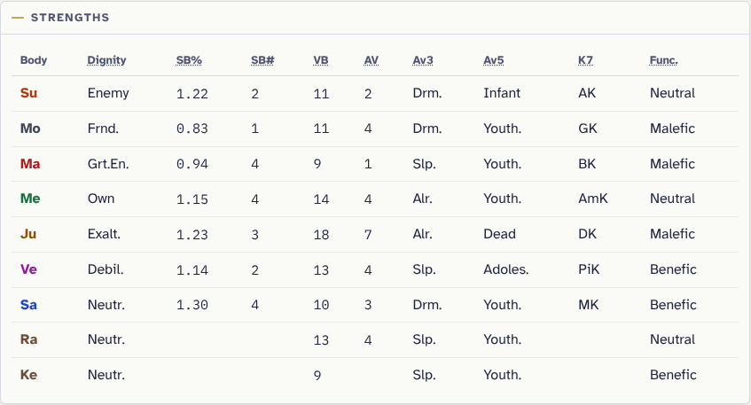

The same columns as PL 9's Page 1. Short labels are PL's own.

| Column | Meaning |
|---|---|
| **Dignity** | The planet's relationship with the lord of the sign it occupies (compound: natural plus temporary). *Exalt.*, *Moolt.* (moolatrikona), *Own*, *Grt.Fr.*, *Frnd.*, *Neutr.*, *Enemy*, *Grt.En.*, *Debil.* |
| **SB%** | Shad Bala as a share of the required strength. **1.00** means exactly the required amount; above 1 is stronger. Sun to Saturn only. |
| **SB#** | How many of the five Shad Bala groups (sthana, dig, kala, cheshta, ayana) reach their minimum. 0 to 5. |
| **VB** | Vimshopaka bala, out of 20. Hold the mouse over it for the exact value. |
| **AV** | Ashtakavarga bindus that the planet has in its own (occupied) sign. |
| **Av3** | Three-state avastha: **Alr.** alert, **Drm.** dreaming, **Slp.** sleeping. |
| **Av5** | Five-state (baladi) avastha: *Infant*, *Youth.*, *Adoles.*, *Old*, *Dead*. PL's order is used, which swaps youth and adolescent compared with BPHS. |
| **K7** | Chara karaka in the 7-karaka scheme: AK, AmK, BK, MK, PiK, GK, DK. Sun to Saturn only. |
| **Func.** | Functional nature for this ascendant: *Benefic*, *Malefic* or *Neutral*. |

Blank cells are blank in PL too: Rahu and Ketu have no SB%, SB# or K7, and
Ketu has no AV.

#### Vimshottari

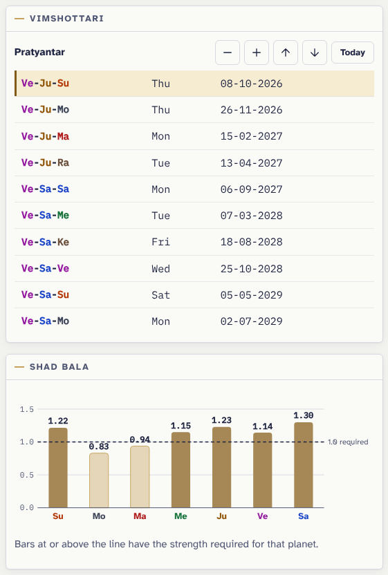

A list of ten periods, as on PL's Page 1. Each row gives the period chain
(for example **Ve-Ju-Su** = Venus maha, Jupiter antar, Sun pratyantar), the
weekday and the date it begins. The period running today is highlighted.
Dates are in the chart's own time zone.

The level name (for example **Pratyantar**) is written at the top left. The
four small buttons do what PL's four buttons do:

- **−** *Show one level higher* (for example from Pratyantar to Antar);
- **+** *Show one level deeper* (down to Deha, the sixth level);
- **↑** *Earlier periods*;
- **↓** *Later periods*.

**Today** brings the list back to the period running now.

For the full dasha tree, use the **Dashas** tab.

#### Shad Bala (bar chart)

One bar per planet, Sun to Saturn. The number on each bar is SB% (total
strength ÷ required strength). The dashed line marks **1.0 required**: a bar
that reaches the line has the strength required for that planet. Weaker bars
are drawn paler. Hold the mouse over a bar to see the total and the required
amount in virupas.

#### How was this computed?

At the bottom of Page 1. Click it to open.

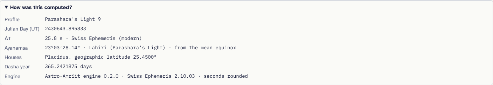

It lists the exact settings used for this chart: the profile, the Julian Day,
ΔT (Delta-T), the ayanamsa, the house system and the latitude used for it,
the dasha year length, the engine version and whether seconds are rounded.
If your result differs from someone else's, compare these lines first.

### 4.2 Strengths

This page shows how every strength number on Page 1 was built up. Values are
in **virupas** (60 virupas = 1 rupa) unless stated.

#### Shad Bala

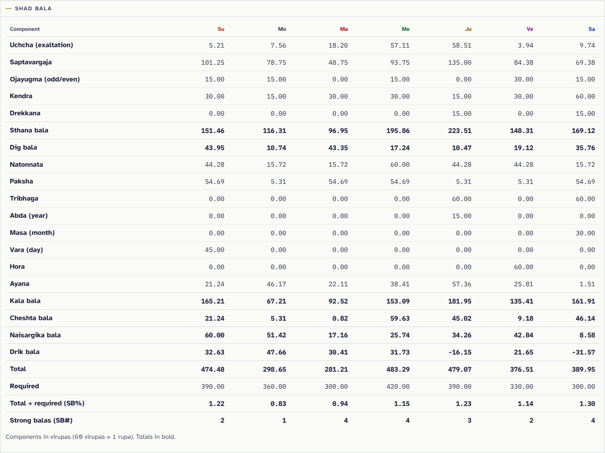

One column per planet, Sun to Saturn. The rows are the parts of Shad Bala;
group totals are in **bold**:

- **Sthana bala** = Uchcha (exaltation) + Saptavargaja + Ojayugma (odd/even)
  + Kendra + Drekkana;
- **Dig bala**;
- **Kala bala** = Natonnata + Paksha + Tribhaga + Abda (year) + Masa (month)
  + Vara (day) + Hora + Ayana;
- **Cheshta bala**, **Naisargika bala**, **Drik bala** (this one can be
  negative);
- **Total**, then **Required** (the minimum for that planet), then
  **Total ÷ required (SB%)** — the SB% of Page 1;
- **Strong balas (SB#)** — the SB# of Page 1. Hold the mouse over it to see
  which groups count.

#### Bhava Bala

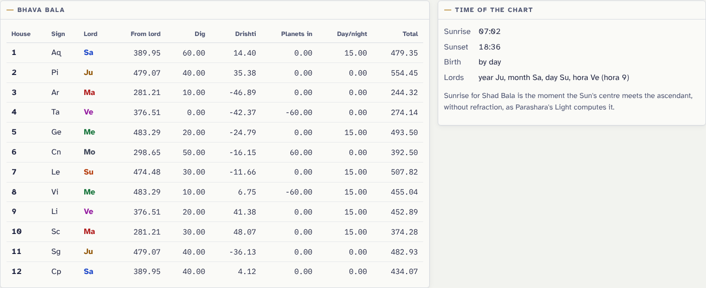

One row per house: **House**, **Sign**, **Lord**, then the parts **From
lord** (the Shad Bala of the house lord), **Dig**, **Drishti**, **Planets in**
and **Day/night**, and the **Total**. The Total is the second number on the
Rasi chart's edge label.

Bhava Bala uses **equal-house** centres (ascendant degree + 30° per house),
because that is what PL 9's own Page 1 matches. The **Yogi & Bhava** page
shows Sripati houses by default, so a planet's house there can differ.

#### Time of the chart

**Sunrise**, **Sunset**, whether the **Birth** was **by day** or **by
night**, and the **Lords** of the year, month, day and hora used in Kala bala.

Sunrise here is the moment the **centre** of the Sun meets the ascendant,
**without refraction**, because that is how PL computes it for Shad Bala.
This is a few minutes later than the sunrise printed in a newspaper or
almanac. This is intended.

#### Ashtakavarga

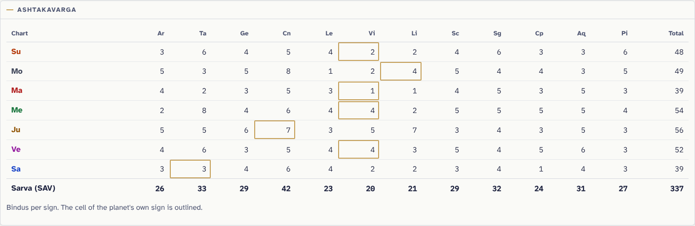

The bindus of each planet's ashtakavarga (one row per planet), sign by sign
from Aries to Pisces, with the row total. The cell of the sign the planet
occupies is outlined: that number is the **AV** column of Page 1. The last
row, **Sarva (SAV)**, adds the seven rows; it always totals 337. These are
the first numbers on the Rasi chart's edge labels.

### 4.3 Vargas

All the divisional charts that PL offers.

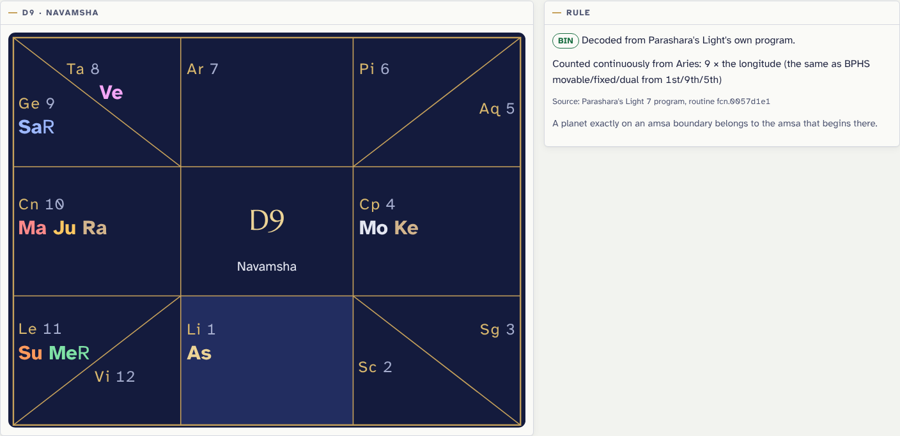

#### Choosing a chart

The three buttons at the top choose a group:

- **16 Parashari** — D1, D2, D3, D4, D7, D9, D10, D12, D16, D20, D24, D27,
  D30, D40, D45, D60;
- **Tajika and D150** — D5, D6, D8, D11, D150;
- **PL alternates** — PL's other versions of some vargas (for example
  *Hora (alternate, 1st/7th)*, *Shodashamsha (alternate)*,
  *Ekadashamsha (alternate)*), and the *Ekadashamsha (Iyer)* placeholder.

The large chart shows one varga. To show another, click its small chart at
the bottom of the page. The chosen small chart has a gold outline.

#### Rule

Next to the large chart, the **Rule** panel says where the rule comes from:

- **BIN** — *Decoded from Parashara's Light's own program.*
- **STD** — *Textbook rule, not yet confirmed against Parashara's Light.*
- **OPEN** — a placeholder. The D11 "Iyer" chart is equal to the alternate
  D11 until the Iyer rule is supplied.

Under it the rule is written in plain words (for example *Counted
continuously from Aries: 9 × the longitude*), followed by a grey **Source**
line naming the routine in Parashara's Light's program that it was read
from. The last line explains
boundaries: *A planet exactly on an amsa boundary belongs to the amsa that
begins there.*

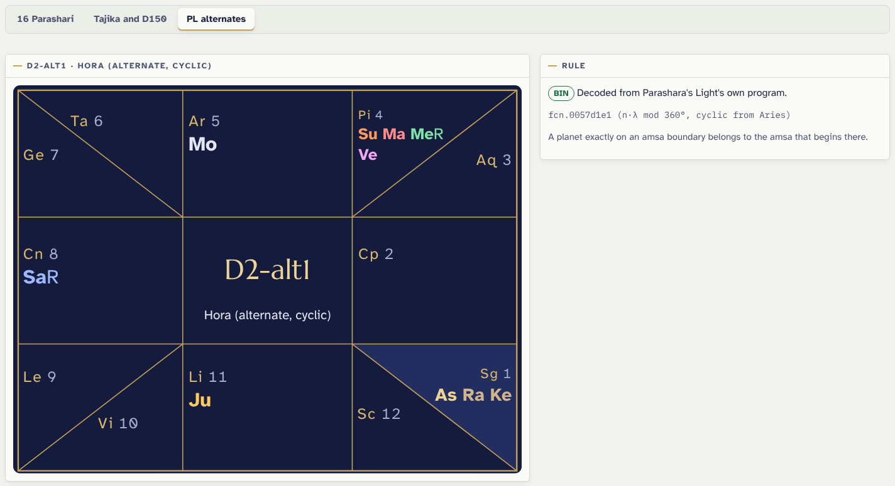

#### Signs in all vargas

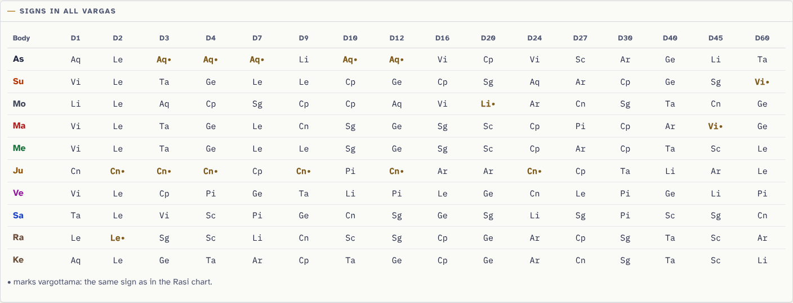

Like PL's worksheet of the same name: one row per planet, one column per
varga of the chosen group, giving the sign. A **•** after a sign (shown in
gold) marks **vargottama**: the same sign as in the Rasi chart.

### 4.4 Dashas

The complete Vimshottari dasha, down to the sixth level.

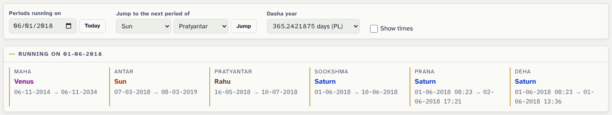

#### The controls

- **Periods running on** — choose any date. The page shows which periods run
  on that date. **Today** returns to today.
- **Jump to the next period of** — choose a planet and a level (Maha, Antar,
  Pratyantar, Sookshma, Prana, Deha) and press **Jump**. The tree opens at the
  next such period after the chosen date. If there is none in the 120-year
  cycle, the app says so.
- **Dasha year** — the length of one dasha year (see below).
- **Show times** — adds the clock time to every date.

The panel **Running on …** shows the whole chain on the chosen date: Maha,
Antar, Pratyantar, Sookshma, Prana and Deha, each with its start and end.
Prana and Deha always show the time, because they last only hours to days.

#### Vimshottari periods (the tree)

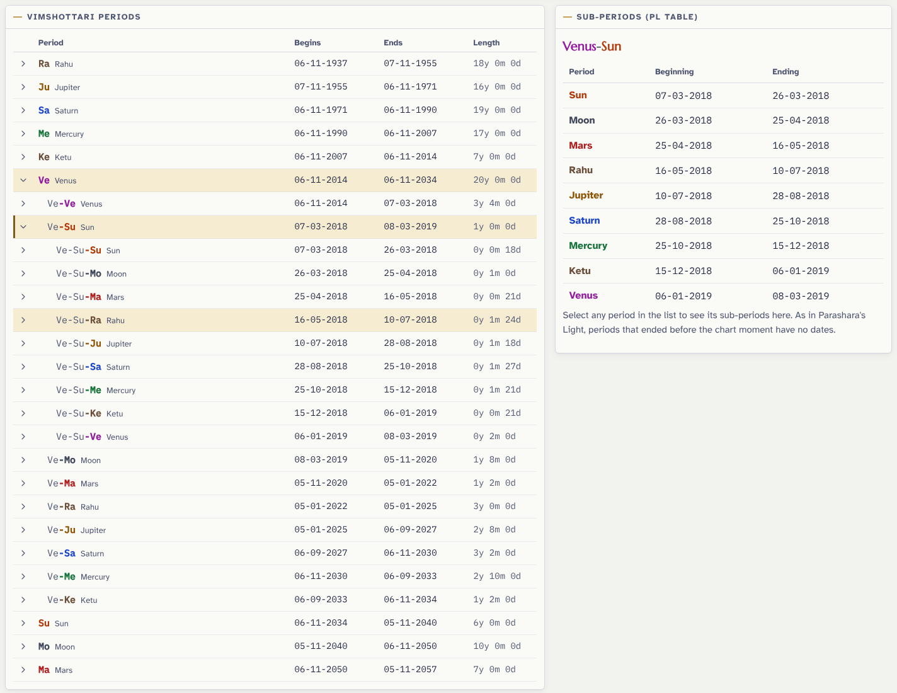

Each row is a period with **Begins**, **Ends** and **Length** (years, months,
days). The arrow at the left opens or closes the next level. Clicking the
period's name selects it; the selected row and the periods running on the
chosen date are highlighted. When the page opens, the path to the chosen date
is already open.

#### Sub-periods (PL table)

The table on the right is laid out like PL's dasha table: a heading such as
**Venus-Jupiter**, then each sub-period with its **Beginning** and **Ending**.
It shows the sub-periods of the period you selected in the tree.

**Why some dates are blank.** As in Parashara's Light, periods that **ended
before the birth** have no dates. In the example, the first mahadasha (Rahu)
began before birth. Its Rahu antar ended before birth, so that row is blank:

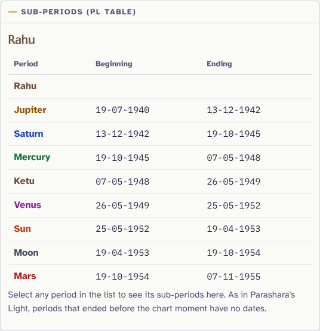

The tree on the left still shows those dates, worked backwards from the
balance at birth, for reference.

#### The dasha year (and why PL's "365.25" is really 365.2421875)

The **Dasha year** list offers:

- **365.2421875 days (PL)** — the default;
- **365.25 days (Kala Chakra)**;
- **360 days**;
- **327.85 days**.

PL's own option is labelled "365.25", but inside the program it uses
**365.2421875** days. This was found in PL's program and confirmed on PL 9's
own screen: with 365.2421875 all 10 dasha dates on the example's PL 9 page
match; with a true 365.25 only 5 of the 10 match. Over 76 years the
difference is only about half a day, but that is enough to move half of the
dates by one day.

Changing the dasha year here changes it **for every chart** (the note
*Changed in Settings; applies to every chart.* appears). To go back, choose
the value again or use **Use the profile value** on the **Settings** page.

### 4.5 KP (Research)

This tab brings K. S. Krishnamurti's KP as his six **KP Readers** teach it
(Casting the Horoscope, Fundamental Principles, Predictive Stellar Astrology,
Marriage, Transits, Horary). It is marked *(Research)*: every rule shown
carries its book (B1–B6) and page, and was checked, where the books allow, on
the Readers' own worked charts (section *What has been checked* below). The
books stay private to the project; the wording is ours.

The tab has seven sub-tabs: **Chart and tables**, **Significators**, **Life
matters**, **Ruling planets**, **Transit timing**, **Horary 1–249** and
**KP Guidance**.

#### Calculation (KP ayanamsa)

| Choice | What it does |
|---|---|
| **Readers mode** (default) | What the Readers use, found by recasting their charts: PL's *Krishnamurti New* ayanamsa, the **mean** node and **365¼-day** dasa years. |
| **Automatic — as PL's KP pages** | PL's Krishnamurti ayanamsa, as PL's KP printouts use (PL 7 manual pp. 218–219). With the *Solar Fire / Kala Chakra* profile the page keeps that profile's Lahiri (the family's KP practice). Node and dasa year from Settings. |
| **PL: Krishnamurti** | PL's Krishnamurti ayanamsa (24°11′54″ on 1 Jan 2025). |
| **PL: Krishnamurti New** | PL's second KP option (24°06′23″ on 1 Jan 2025). |
| **Same as the chart (Settings)** | The settings of every other page. The longitudes are then exactly those of Page 1. |

The line under the list says which ayanamsa, house system, node and dasa
year the page used. A planet near a boundary can change its sub lord between
this tab and Page 1; that is expected.

**Changing the ayanamsa for the whole app.** If you want *every* page in
Krishnamurti, go to **Settings → Calculation → Ayanamsa** and choose
**PL: Krishnamurti**. **Use the profile value** puts it back.

#### Chart and tables

PL's Krishnamurti chart and KP significator tables, as before, and the
position of **Fortuna** (ascendant + Moon − Sun, B1 p. 129).

##### Krishnamurti chart

The chart is drawn in the East Indian style, as Kala Chakra draws it.
The houses are **Placidus**, and the ascendant is the **beginning** of
house 1, not its centre. Each sign lists:

- the **cusps** that fall in it: number, degree:minute, star lord / sub lord
  (for example `1 01:57 Ma/Ke`);
- the **planets**: degree:minute, star lord / sub lord, and **-house**, the
  house the planet occupies (for example `Mo 10:19 Ra/Ju-8`).

A house runs from its cusp to the next cusp, so a planet's KP house can
differ from its house in the Rasi chart. As in PL, the signs carry no house
numbers: in KP a sign can hold two cusps or none. On a phone the chart
shows only cusp numbers (`C1`) and planets with their houses (`Mo-8`). The
tables below give the full detail.

##### Cusps and Planets

For every cusp and planet: longitude, **sign lord**, **star lord**, **sub
lord** and **sub-sub lord**. The planet table also gives the KP house. The
lords are computed with the same rule as Page 1 and Kala Chakra.

##### Significators of the houses

For each house, the columns PL prints:

- **Occupants** — planets in the house.
- **Tenants (occupants)** — planets placed in the nakshatras of the occupants.
- **Owner** — lord of the sign in which the cusp falls.
- **Tenants (owner)** — planets placed in the nakshatras of the owner.

Rahu and Ketu own no sign, but they own nakshatras, so they can have
tenants. A dash (–) means none.

##### Significators of the planets

The same table read planet by planet, with the textbook KP levels:

- **A** — houses occupied by the planet's star lord;
- **B** — the house the planet occupies;
- **C** — houses whose cusp falls in a sign of the star lord;
- **D** — houses whose cusp falls in a sign of the planet.

Note: these are PL's significators. Kala Chakra's power calculation (the
cusp-number vector, with its span rule and node dispositors) is a
different, family-specific method. It stays in Kala Chakra.

#### Significators (Krishnamurti's order)

For each house, the planets that signify it, in Krishnamurti's order of
strength (B6 pp. 94–95; B3 p. 418):

1. planets in the stars of the occupants;
2. the occupants;
3. planets in the stars of the owner (lord of the cusp's sign);
4. the owner;
5. planets conjoined with (same sign) or aspected by those above.

**Rahu and Ketu act as agents**: a node signifies its own house, the houses
of its star lord, and the full results of the planets it is conjoined with,
aspected by, and of its sign lord; it is stronger than the planets it
represents. A planet in a node's star takes the node's whole set. A planet
whose star holds no planet is a strong significator itself. The second table
lists the houses each planet signifies, and for a node the planets it
represents. These sets reproduce the tables printed in B6.

#### Life matters

**Is it promised?** For each of 14 matters (marriage, children, service,
business, wealth, house, vehicle, education, abroad, health, litigation,
speculation, change of job, spiritual life) the table shows the cusp KP
judges, its **sub lord**, the sub lord's star lord, the houses the sub lord
signifies, the matter's "yes" and "no" houses, and the result:
*promised*, *mixed* (promised with obstacles), *denied* or *not shown*.
An asterisk marks a "no" group the books do not print (derived by the
12th-from rule). Click a matter for its chain (cusp → sub lord → star lord →
houses), the book's notes and variants, and its significators strongest
first.

**Candidate periods.** Dasa–Bhukti–Anthra periods whose three lords all
signify the matter, with each lord's level and a strength (15 = all three at
level 1). Read the yellow note: these are **candidates, not predictions**.
On the Readers' own 11 marriage charts every wedding fell in such a period,
but the strength rank alone barely singled it out. Krishnamurti narrows the
list with the ruling planets of the moment of judgement — tick **Only
periods whose lords are all ruling planets now** — and fixes the day by
transit: **Transit days** opens the next sub-tab for that period. Choose the
years with **From year / To year**; **Only the strongest quarter** hides the
weaker candidates.

#### Ruling planets

The ruling planets of the **moment of judgement**: now at the chart's place,
or a moment you set with **Set moment** (**Use now** goes back). The table
gives the lord of the rising sign and star, of the Moon's star and sign, of
the day (sunrise to sunrise), and the finer sub lords; then the nodes acting
for them, the planets rejected because they sit in the star or sub of a
retrograde planet, and the ruling planets strongest first (B6 pp. 132–152,
194, 254, 285).

**Birth-time rectification.** Ask the question, then **Find birth times**:
the app searches the given minutes either side of the birth time for the
moments whose rising degree has its sign, star, sub and sub-sub lords all
among the ruling planets (B6 pp. 146–152). The Readers then choose by day
or night and take the middle of the sub-sub. Nothing changes your chart;
enter a chosen time with **Edit chart**.

#### Transit timing

For a period (the running one, or the one sent from Life matters), the
stretches of time a body spends in a sign, star and sub **all ruled by the
period lords** — Jupiter for the year, the Sun for the month, the Moon for
the day (B5 pp. 226–229; B6 p. 334). Tick extra planets (ruling planets,
strong significators) to widen the set. Times are in the chart's zone.

#### Horary 1–249

The family's horary method in KP. Ask the querist for a **number from 1 to
249**; set the **moment of judgement** (now by default) and choose the
**question**. The number's sign–star–sub unit gives the ascendant; the other
cusps are found for it at the latitude of judgement; the planets, the ruling
planets and the dasa are those of the moment (B6 pp. 108–113).

**Judgement** shows the three conditions for the question's cusp (B6,
KP6-061): (i) the sub lord is direct (if retrograde: delay until it turns
direct); (ii) its star lord is direct (if retrograde: denied); (iii) the sub
lord signifies the question's houses. Then the significators of those houses,
the ruling planets, the dasa running at judgement and the periods whose
lords are both significators and ruling planets in the next five years. Fix
the day with Transit timing. The question list is B6's master table of house
groups.

#### KP Guidance

The Readers' rules that **hold for this chart**, grouped by area of life,
each with its book and page and, in brackets, the condition that fired.
435 chart rules from the six books are tested (and 88 principles shown for every chart); rules that hold for almost
every chart were removed because they say nothing about this one.
*Principles of judgement* at the bottom are the points that apply to every
chart (how KP reads a chart), and the traditional rules Krishnamurti rejects
(Sade Sati and others), marked as tradition.

Left out on purpose, as on the NTP page: death, longevity, accidents,
danger and disease prognosis.

#### What has been checked

On the Readers' own worked examples (tests in `kaast2/tests/`): the
significator tables of B6; 45 horary ascendants and 37 horary charts; the
dasa periods B6 names at 32 dated events; 7 horary judgements; the ruling
planets of 15 judgement moments; 11 natal marriage charts (dasa at the
wedding, significators, promise); 5 transit dates; both rectification
cases. Where the books contradict themselves, the test names the case.
Full account: `kaast2/docs/specs/kp_research.md`.

### 4.6 NTP (Research)

The tab is marked *(Research)*: Iyer's methods are an area of study in progress, not a settled
reading.

This page applies H. R. Seshadri Iyer's *New Techniques of Prediction*
(three volumes: NTP-1, NTP-2, NTP-3) to the chart. Every point shown carries
its volume and the **source PDF page** of the copy kept with the project
(`references/NTP/`), so you can look it up. Wording is a short paraphrase,
not the book's text.

Only rules whose conditions **this chart meets** are listed. Iyer's rules
were never tested against outcomes here. Read them as the book's guidance for
the astrologer, not as a final judgement.

#### NTP Guidance

The top panel lists the points that matter most for this chart:

- the Birth Yogi, the Duplicate Yogi, the Avayogi and the Yogi's set of three;
- the chart-wide rules that apply: Lagna in the Yogi's star, the Lagna lord
  as Yogi, Zero Rasis on dusthanas, and the yogas of NTP-1 ch. V (Raja,
  Viparita, Gaja-kesari, Kartari and others);
- the planets whose Dasha Iyer's rules point clearly to good or bad;
- the running Mahadasha and Bhukti, read by Iyer's Dasha chart.

Each line is tagged **Good**, **Bad**, **Mixed** or **Note**. The colours
only repeat those words.

#### Yoga, Avayoga and the sets of three

- **Birth Yoga point** = Sun + Moon + 93°20′. Its star's lord is the **Birth
  Yogi**, and the lord of its sign is the **Duplicate Yogi** (NTP-2 p. 5).
- **Avayogi**: Iyer gives every planet exactly one enemy (NTP-2 p. 6):
  Sun–Saturn, Moon–Mercury, Mars–Ketu, Mercury–Mars, Jupiter–Sun,
  Venus–Jupiter, Saturn–Moon, Rahu–Venus, Ketu–Rahu. The Yogi's enemy is the
  Avayogi.
- **The sets of three** (NTP-2 p. 6): {Ketu, Moon, Jupiter}, {Venus, Mars,
  Saturn}, {Sun, Rahu, Mercury}. When one planet of a set is the Yogi, the
  other two take on yoga character as well. With Rahu this is specially
  noticed: Rahu becomes yoga-like when the Sun or Mercury is the Yogi. The
  Avayogi's set leans the other way. The page marks the Yogi's set in green
  and the Avayogi's in red.
- **Birth yoga**: its effect as Iyer lists it (NTP-1 pp. 22–24). He says these
  are the only birth-element effects that stand the test.
- **Zero Rasis**: the burnt (Dagdha) signs of the birth tithi, from Iyer's
  table (NTP-1 pp. 17–18). Bhavas counted from them, their lords and planets
  in them lose power unless retrograde.

#### Planets by Iyer's rules

There is one card per planet. It gives:

- **position**: sign, Sripati bhava, star and star lord;
- **states**: Birth Yogi, Duplicate Yogi, Avayogi, Exalted, Debilitated, Own
  sign, Zero Rasi, Combust (Iyer's "eclipsed"), Retrograde, Yogi's set or
  Avayogi's set;
- **character**: Positive, Negative or Mixed, with the reasons (NTP-2 pp. 7–9).
  Lords of bhavas 1, 2, 4, 5, 7, 9, 10 and 11 that are not Zero Rasis are
  positive, and so are the Yogi and the Duplicate Yogi. Lords of 3, 6, 8 and
  12, lords of Zero Rasis, the Avayogi, Rahu and Ketu are negative. A planet
  with both kinds of reason is mixed; its rules are marked **Positive side**
  or **Negative side**.
- **rules**: every Iyer rule the planet meets. These cover Theories 1–34 of
  NTP-2 ch. I, and NTP-1's rules on:
  - exaltation, debilitation and Neecha Bhanga, with the Bhukti in which the
    cancellation shows;
  - own sign, combustion, and functional and natural nature;
  - degree of effect and aroha/avaroha (whether the bhava's results grow or
    decline through its period);
  - karaka in bhava, bhavat bhava, Digbala and Sookshma lordship.
- **Its Dasha and notes** (click to open):
  - what its Dasha tends to give, for which bhavas;
  - its **Graha Samayam**, one of 27 "planetary states" (NTP-1 pp. 28–30);
  - the areas of life its Dasha favours or harms;
  - its **three stars** in Iyer's Mathematical Navamsha (NTP-2 p. 83).

The card's overall tag (Good, Bad, Mixed) is the balance of its rules, not
Iyer's own word.

#### Dasha and Bhukti by Iyer's Dasha chart

Choose any Mahadasha; the running one is preselected.

- **Graha Samayam of the Dasha lord**, the **Dasha Yogi** and the **Dasha
  Raja Yogi** (NTP-2 pp. 29–30, 36).
- **Dasha rules** (NTP-2 pp. 36–38). In Iyer's Dasha chart each planet
  "crosses" a **Starter** and a **Ruler**. For example: "the Birth Yogi
  crosses the Dasha Yogi: a very powerful Dasha".
- **What the Dasha gives, area by area** (NTP-2 pp. 57–63, 82). Iyer reads a
  Dasha through the division charts, one area of life each:

  | Chart | Area | Chart | Area |
  |---|---|---|---|
  | D-3 | co-borns | D-11 | gains without effort |
  | D-4 | assets | D-12 | parents |
  | D-5 | spirituality | D-16 | happiness, vehicles |
  | D-6 | health | D-20 | worship |
  | D-7 | children | D-24 | education |
  | D-8 | longevity | D-27 | stamina |
  | D-9 | partner | D-30 | happiness and misery |
  | D-10 | profession | D-40 | auspicious effects |
  |  |  | D-45 | character |

  The Dasha lord's house from each chart's own Lagna decides:
  - houses 3, 6, 8 and 12 are always bad for that area (Mars in the 6th is
    the exception);
  - the 2nd is neutral, the rest good.

  The table also shows the strengths that add to the result (exaltation,
  Vargottama, own sign, Digbala) and the special rules (karaka in its own
  D-Lagna, lord of the D-Lagna, a strong Jupiter's relief).

  The charts are built **Iyer's way**. His D-11, D-16, D-30 and D-45 differ
  from Parashara's Light (the Vargas page shows PL's). Iyer's death and
  widowhood readings are deliberately not shown.
- **Bhuktis**: for each Bhukti:
  - the Starter and the Ruler;
  - the tone at the start and at the end. The Ruler decides the end, and Iyer
    calls it the more important (NTP-2 p. 34).
  - the rules behind them, with **Dasha chart** rules (NTP-2 pp. 34–36) and
    **classical** rules (NTP-2 pp. 86–89) shown separately. The classical
    rules cover:
    - the Bhukti lord in the 3rd, 6th, 8th or 12th from the Dasha lord;
    - its position from the Lagna;
    - "guest" and "tenant";
    - whether the two lords are related at all ("without such relationship
      no results happen").

#### How this page reads the chart

- **Houses** are Sripati bhavas: a bhava's lord is the lord of the sign
  holding its middle, and a planet's bhava is the span it lies in
  (NTP-1 pp. 93–97).
- **Rahu and Ketu**: the page uses the **mean node**, as Iyer says ("Take
  always Mean Rahu", NTP-1 p. 101). You can switch to the chart's own
  setting. The ayanamsa is the chart's (Lahiri in the PL profiles, as Iyer
  uses).
- **Combustion orbs**: Iyer gives none, so the app's standard orbs are used.
  Iyer took combustion from the panchanga.
- **Week day** for the Dasha chart: sunrise to sunrise (NTP-1 pp. 15–16).

**What was checked:**

- The Dasha chart reproduces Iyer's worked Chart 1 exactly: all 10 Starters
  and Rulers, the Raja Yogi and the Dasha Yogis (NTP-2 pp. 23–34).
- The division charts match his own Chart 1 table in 167 of 170 cells. The
  other 3 are misprints in the book.
- The Mathematical Navamsha reproduces all 7 of his worked examples.

**Not checked:** whether his rules predict well. That is for you to judge.

#### Marriage matching (Iyer) — on the NTP (Research) tab

Iyer judges a match from the charts themselves (NTP-2 pp. 147–151) and calls koota marks
"very very secondary". The panel shows, each with its page:

- **From this chart alone:** the Lagna lord and 7th lord (6/8 or 2/12 apart, joined or in aspect,
  hostile or not), Gana by the gunas of those two lords, the 7th lord and the Birth Yogi,
  amicability (the 7th lord aspecting the Lagna or joining its lord), and **Kuja Yoga, not Kuja
  Dosha**: the traditional Mars placement is shown, but Iyer rejects it as a rule; if Mars is the
  Birth Yogi he always does good.
- **The other chart:** enter the other person's birth details (the same form as the main chart).
  The app does not store it. The same chart is used on the Matching tab.
- **Mutual verification:** the two Lagna lords; each 7th lord (or its cusp's star lord) against the
  other's Birth Yogi; a Lagna in the other's Yoga star; the two Lagnas not 6/8 or 2/12; the other's
  Yogi aspecting the Lagna.
- **The kootams Iyer still checks:** Nadi and Rajju. He also names an "Ayur kootam" but never
  defines it in NTP, so the app says so instead of guessing.

### 4.7 Yogi & Bhava

#### Yogi points

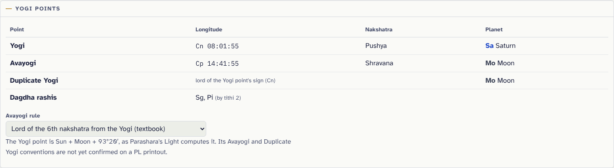

| Row | Meaning |
|---|---|
| **Yogi** | The Yogi point (Sun + Moon + 93°20′), its nakshatra, and the planet that rules that nakshatra (the Yogi planet). |
| **Avayogi** | The Avayogi point and planet. |
| **Duplicate Yogi** | The lord of the sign holding the Yogi point. |
| **Dagdha rashis** | The "burnt" signs for the tithi of the chart (the tithi number is shown). |

PL's Yogi point is decoded from its program. How PL finds the **Avayogi** is
not yet confirmed, so you can choose the rule under **Avayogi rule**:

- **Lord of the 6th nakshatra from the Yogi (textbook)** — the default;
- **Point opposite the Yogi point (PL dictionary wording)**.

The two rules can give different planets. In the example the first gives
the Moon and the second the Sun.

#### Bhava chalit

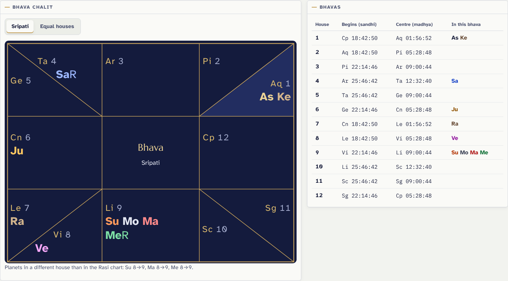

Choose **Sripati** (the default) or **Equal houses**.

- **Sripati**: the ascendant and the midheaven are the centres of houses 1
  and 10; each quadrant is divided into three; each house begins (sandhi)
  half-way between two centres.
- **Equal houses**: each house is 30°, centred on the ascendant degree plus
  30° per house.

The chart is drawn with the fixed East Indian signs. Each planet is placed
in the sign of the **centre of its bhava**, so the chart shows the houses,
not the planets' actual signs. The line under the chart lists the planets
whose house differs from the Rasi chart, for example *Su 8→9* (8th house in
the Rasi chart, 9th in bhava chalit).

The **Bhavas** table gives, for each house, where it **Begins (sandhi)**, its
**Centre (madhya)**, and the planets **In this bhava**.

### 4.8 Jaimini

#### Chara karakas and special lagnas

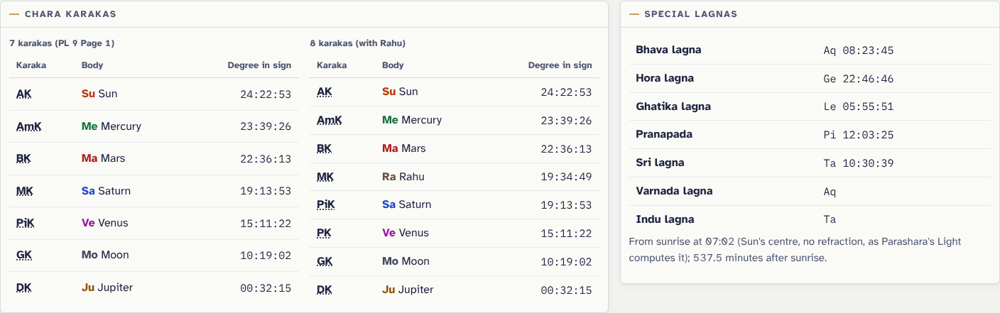

**Chara karakas** are shown twice:

- **7 karakas (PL 9 Page 1)** — Sun to Saturn, by degree within the sign,
  highest first: AK, AmK, BK, MK, PiK, GK, DK. This is the K7 column of Page
  1.
- **8 karakas (with Rahu)** — Rahu is included, counted as 30° minus its
  degree, and the scheme has eight karakas (with PK).

Hold the mouse over a karaka for its full name.

**Special lagnas**: **Bhava lagna**, **Hora lagna**, **Ghatika lagna**,
**Pranapada**, **Sri lagna** (with degrees), **Varnada lagna** and **Indu
lagna** (sign only). The note underneath gives the sunrise used and the
minutes from sunrise to the chart moment. Sunrise is again the Sun's centre
without refraction, as PL computes it.

#### Arudha padas and Karakamsha

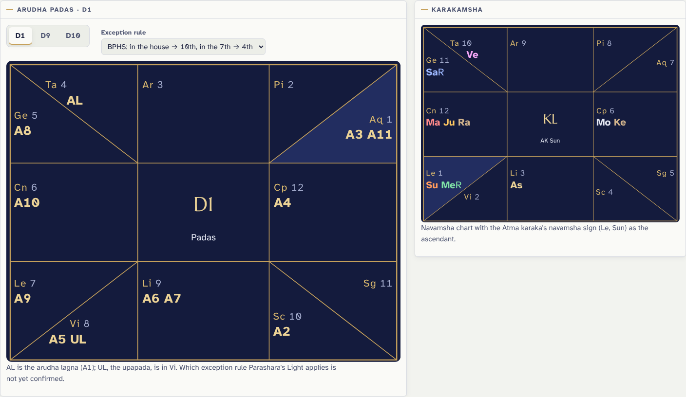

**Arudha padas**: choose the chart (**D1**, **D9** or **D10**). The chart
shows **AL** (the arudha lagna, A1), **A2** to **A11**, and **UL** (the
upapada, A12) in their signs.

**Exception rule**: what to do when the pada falls in the house itself or in
the 7th from it. PL's choice is not yet confirmed, so you can choose:

- **BPHS: in the house → 10th, in the 7th → 4th** (the default);
- **PL tutorial: lord in the 7th → 4th**;
- **No exception**.

**Karakamsha**: the navamsha chart, re-drawn with the Atma karaka's navamsha
sign as the ascendant (marked **KL**, with the AK named in the centre).

#### Argala and Rashi drishti

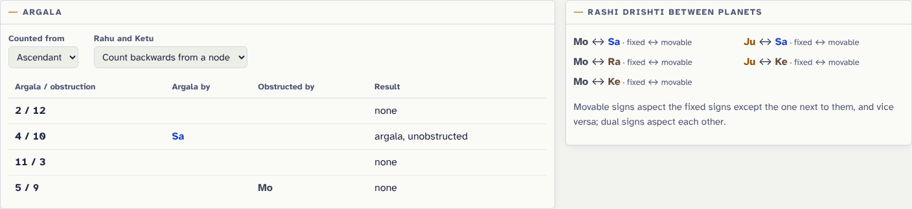

**Argala**: choose the point to count from in **Counted from** (the
**Lagna (ascendant)** or any planet), and how to treat Rahu and Ketu in **Rahu and
Ketu**:

- **Count backwards from a node** (the default);
- **Nodes cause argala in reverse**;
- **No reversal**.

Each row gives the argala house and its obstruction house (for example
**4 / 10**), the planets causing argala (**Argala by**), the planets
obstructing it (**Obstructed by**), and the **Result**: *none*, *argala,
unobstructed*, *argala prevails*, *obstructed*, or *equal: decided by
strength*.

**Rashi drishti between planets**: every pair of planets that aspect each
other by sign, and whether by **dual signs** or **fixed ↔ movable**. Movable
signs aspect the fixed signs except the one next to them, and the other way
round; dual signs aspect each other.

### 4.9 Transits

*The Transits page is new and still being finished. Its layout may change.*

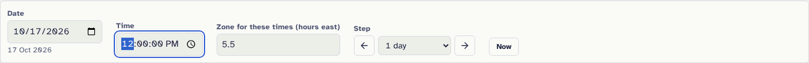

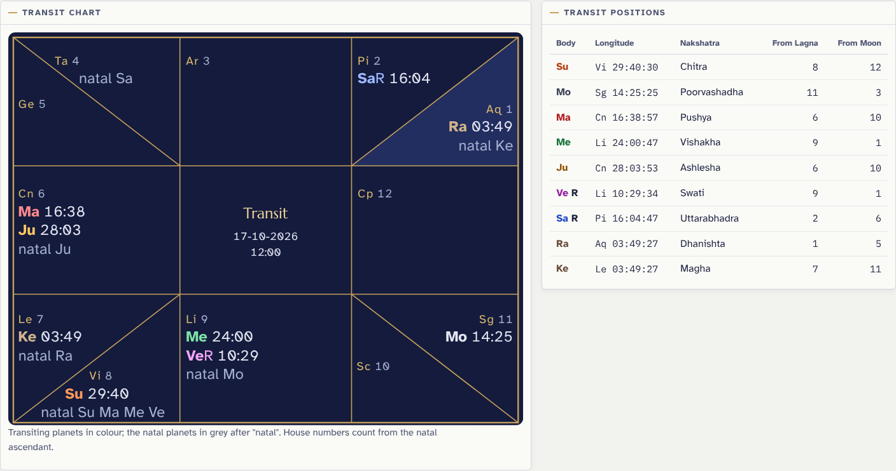

#### Choosing the moment

- **Date** and **Time** — the moment of the transit. It opens at the
  present moment.
- **Zone for these times (hours east)** — the zone in which the transit
  times are shown. It starts with the chart's zone. For a war-time chart it
  starts at 5.5, because war time has ended.
- **Step** — choose a step (**1 second**, **1 minute**, **1 hour**, **1 day**, **1 week**,
  **1 month**, **1 year**, **10 years**) and press the arrows: **←** steps
  back, **→** steps forward.
- **Now** returns to the present moment.

#### Transit chart and positions

The **Transit chart** shows the transiting planets in colour with their
degrees. The natal planets are written in grey after the word *natal*. House
numbers count from the **natal** ascendant.

**Transit positions** lists each planet's sign, degrees and nakshatra, and
its house counted **From Lagna** (natal ascendant) and **From Moon** (natal
Moon). An **R** after the planet means it is retrograde.

#### Coming changes

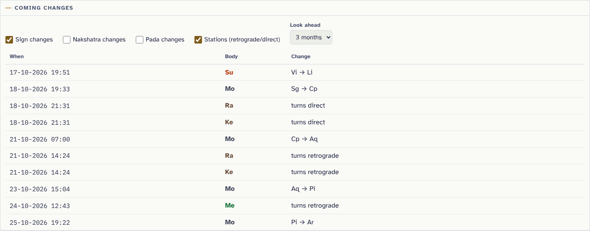

Tick the kinds of change you want: **Sign changes**, **Nakshatra changes**,
**Pada changes**, **Stations (retrograde/direct)**. Choose how far to **Look
ahead** (1 month, 3 months or 1 year). The table lists **When** (in the zone
chosen above), the planet (**Body**) and the **Change**, for example
*Vi → Li* or *turns retrograde*.

Rahu and Ketu are the **true** nodes (unless changed in Settings). The true
node wobbles, so it can turn direct and retrograde again within a few days.

#### Sade Sati, Jupiter and Saturn returns

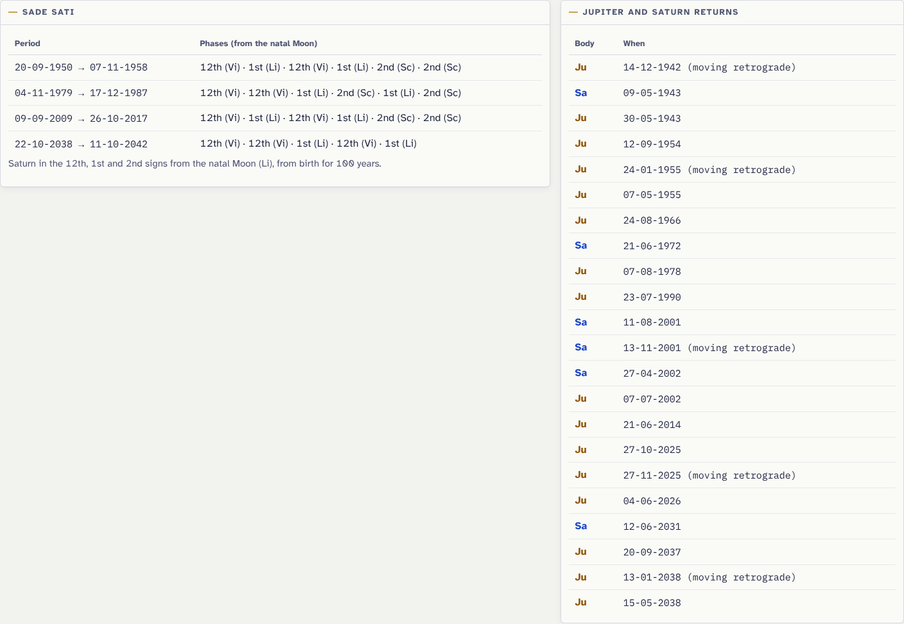

**Sade Sati** lists the periods when Saturn is in the 12th, 1st or 2nd sign
from the natal Moon, from birth for 100 years. The phases show each sign in
turn. Saturn's retrograde motion can take it back into a sign, so a phase may
appear more than once.

**Jupiter and Saturn returns** lists each date on which Jupiter or Saturn
comes back to its natal degree. When a planet passes the degree three times
(forward, back while retrograde, forward again), each pass is listed, the
backward one marked *(moving retrograde)*.

### 4.10 Page 1 (Experimental)

Five sub-tabs, chosen with the buttons at the top. Each rule is written on the page where it is
used. Where a Parashara's Light 7.0.1 printout was available, the page says it matches.

**Highlights.** Choose any chart (the Rasi or any divisional chart). The chart shows each
planet's state as a short code, and the table spells it out: **Exalted**, **Moolatrikona** (Rasi
only), **Own sign**, **Debilitated**, **Vargottama** (same sign in the Rasi and the Navamsha),
**Dig bala**, **Retrograde**, **Combust**, and **In the 3rd / 6th / 8th / 12th** of that chart (the
3rd in amber, as a mild dusthana). House numbers in red on the chart mark those houses.

**Conjunctions** — what the app counts: two planets in **the same sign** are conjunct, as in PL
(PL has no degree orb). Within the orb you set (default **3°**, your rule of thumb) a conjunction is
marked *close*. Two of Mars, Mercury, Jupiter, Venus and Saturn within 1° are in **planetary war**.
Planets within the orb but in neighbouring signs are listed separately as *not* conjunct.

**Across the divisional charts:** each planet's sign and house in all 16 Parashari charts, with ▲
exalted, ● own sign or moolatrikona, ▼ debilitated, and a count per planet.

**Lordships & yogas.** PL's *Lordships* worksheet for any chart: "Lord of N in M", with **\*** for an
exchange (parivartana). Houses are whole signs from that chart's own Lagna. Matches a PL 7.0.1
printout for D1, D9 and D10. Below it, the **yogas**: Parashara's Light's "1001 Yogas" tested with
PL's own conditions. Filter by positive / partly positive, by group, or search by name (Dhana,
Raja, Gaja…). Each yoga shows PL's definition and result, and its PL condition. Some yogas depend
on the native's sex: set **Native** to evaluate them. **Angaraka** and **Guru-Chandala** are not in
PL's database; they are shown separately as textbook yogas. PL tests yogas on the Rasi only;
choosing a divisional chart applies the same conditions to that chart (our extension).

**Aspects.** PL's worksheets 21 and 22: the *Aspects between planets* matrix (the sign aspect ¼ ½ ¾
or full, and the exact aspect in virupas; the colour is how the aspected planet regards the
aspecting one: green friend, blue neutral, red enemy), and bar charts of the aspects **from** and
**on** each planet. Then **Aspects on houses**: on the nth house, or on the nth house + its lord (half
each), one graph per house or per planet, with the house point at the Lagna's degree in each sign
(PL's rashi chart) or at the Sripati cusps. All 72 matrix cells match a PL 7.0.1 printout.

**Strength worksheet.** PL's worksheet 14: SB%, SB#, War, Ishta/Kashta, Dominance and Func. per
planet, the Shad Bala bars, and Bhava Bala by component as PL prints it. Dominance and Func. match a
PL 7.0.1 printout for all nine planets; Ishta/Kashta matches for the Sun, Moon and Saturn and is
within 1–2 virupas for the others. PL 7.0.1 always leaves War blank; **W\*/L\*** mark a textbook
planetary war (our addition).

**Nandi Nadi (research).** Bhrigu Nandi Nadi (the "Nandi Nadi" of KRS's course) as taught from R. G.
Rao's *Bhrigu Nandi Nadi*. The Lagna is not used: each planet is read from its own sign and stands
for people and matters (Jupiter the native, Saturn work, Venus the wife, Mars brothers or a
woman's husband, Sun father, Moon mother, Mercury education, Ketu religion). The tab shows the
links between planets (same sign, 2nd, 12th, 7th, trines; a retrograde planet also acts from the
previous sign; exchanges), a card per karaka, and Jupiter's and Saturn's transits over the natal
planets, with their rounds from birth. Contested points carry their source; nothing is scored.
This is research: it is not checked against reference charts.

### 4.11 Matching

Compatibility of two charts as Parashara's Light 7 reports it (Reports → Compatibility). Enter the
**prospective match** (or choose *Use another chart* to enter both), and say whether the first chart
is the **boy** or the **girl**: the kootas count from the girl's Moon star to the boy's. The second
chart is never stored.

- **Overview:** Ashtakoot out of 36 with PL's bands (16 or less avoid, 17–21 medium, 22–30 good, over
  30 excellent), Dash-Koota out of 44, the BV Raman total out of 36, and Mangala Dosha.
- **Basic birth details, Charts and planets, Moon chart, Navamsha and Dashas** of both, side by side,
  including Varna, Vashya, Yoni, Gana, Nadi, Rajju and the name syllable.
- **Ashtakoot:** the eight kootas with both persons' values, the marks and the area of life, and any
  Gana, Bhakoot or Nadi Maha Dosha.
- **Mangala Dosha:** Mars from the Lagna and from the Moon for each, then PL's 25 cancelling
  conditions that apply ("inferred" marks a reading of PL's formula that PL does not document).
- **Dash-Koota:** the ten Kalaprakasika kootas plus gender, gothra and caste, with the totals.
- **Krishnamurti (KP):** Krishnamurti's view (KP Reader 4): judge each chart first; the kootas are
  secondary. His own test: are each partner's birth ruling planets significators of the other's
  houses 2, 7 and 11 (both charts recast in KP Readers mode)? Then his notes on each koota and on
  Mars dosha, with pages.

The rules were read from PL 7's own program. A real PL 7.0.1 printout (Ashtakoot and Dash-Koota for
one couple) is reproduced row for row. PL differs from some textbooks in two places: Tara is counted
one way only (3 for Janma or Sampat, else 1.5) and two neutral sign lords score 1 in Graha Maitri.

---

## 5. Settings

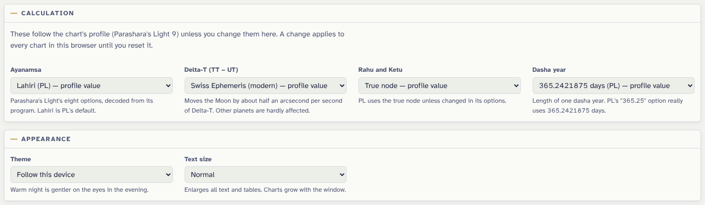

### Calculation

These are the settings that PL lets you change in its calculation options.
Each list shows the chart's own profile value, marked **— profile value**.

**Important:** a change here applies **to every chart in this browser**
until you change it back. When a setting differs from the profile, a
**Use the profile value** button appears under it. Press it to undo the
change.

| Setting | Choices | What it changes |
|---|---|---|
| **Ayanamsa** | PL's eight options — Lahiri (PL's default), None (tropical), Yukteshwar, Raman, Bhasin, Fagan–Bradley, Krishnamurti, Krishnamurti New — plus *Lahiri (Solar Fire / Kala Chakra)* | Every sidereal longitude: all planets, the ascendant, houses, vargas, nakshatras, dashas, strengths. |
| **Delta-T (TT − UT)** | *Swiss Ephemeris (modern)*, *Parashara's Light 7 table and curve*, *Solar Fire 9 curve* | The small correction between clock time and astronomical time. It moves the Moon by about half an arcsecond per second of Delta-T. Other planets are hardly affected. |
| **Rahu and Ketu** | *True node*, *Mean node* | The position of Rahu and Ketu (and everything that depends on them). PL uses the true node unless changed in its options. |
| **Dasha year** | 365.2421875 days (PL), 365.25 days (Kala Chakra), 360 days, 327.85 days | All dasha dates. See [The dasha year](#the-dasha-year-and-why-pls-36525-is-really-3652421875). |

### Saved places

Your own list of places with their coordinates and zone. They appear in the
**Place** list when you cast a chart, alongside the built-in places.

1. Type the **Place** name, its **Latitude** and **Longitude** (decimal, or
   degrees-minutes-seconds such as `21 42 12 N` and `84 01 53 E`) and its
   **Zone (hours east of UTC)**.
2. Press **Add place**. It appears in the table below, with the coordinates
   written out as degrees, minutes and seconds so you can check them.
3. **Edit** puts a place back into the boxes; change it and press **Save
   changes**. **Delete** asks *Delete …?* — press **Yes, delete** to remove it.
4. **Export places** saves all your places to a file
   (`astro-amriit-places.json`). **Import places…** reads such a file back;
   places with the same name are replaced, others are added.

Saved places are kept **in the browser on that device** (the phone and the
computer each keep their own list). Use **Export places** on one and
**Import places…** on the other to copy your list across, and keep the file
as a backup. The **Save this place** button on the chart form adds to the
same list. For Indian places, war time (1942–45) is applied to saved places
too. A place saved from the world atlas keeps its time zone, so later charts
there get the zone and daylight saving of their own dates.

Under the built-in places, a line credits the **world atlas** (about 86 000
places from GeoNames, CC BY 4.0) and repeats how its zones are found.

The **Calculation** profile in the chart form chooses all of these at once
for one chart. The Settings page changes one of them for all charts.

### Appearance

**Theme**:

- **Follow this device** — light or dark, whichever your computer or phone is set to;
- **Light** — used for most pictures in this guide;
- **Dark**;
- **Warm night (less blue light)** — gentler on the eyes in the evening.

The round button at the top right of every page also switches the theme, in
the order Light → Dark → Warm night. Hold the mouse over it to see which
theme it will switch to.

In every theme the chart is drawn as a dark "plate" with gold lines.

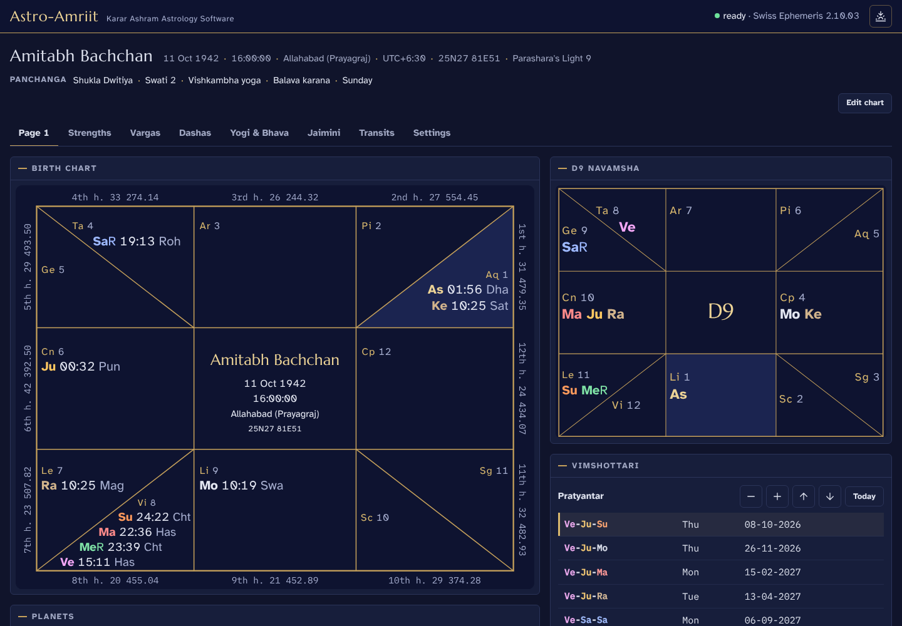

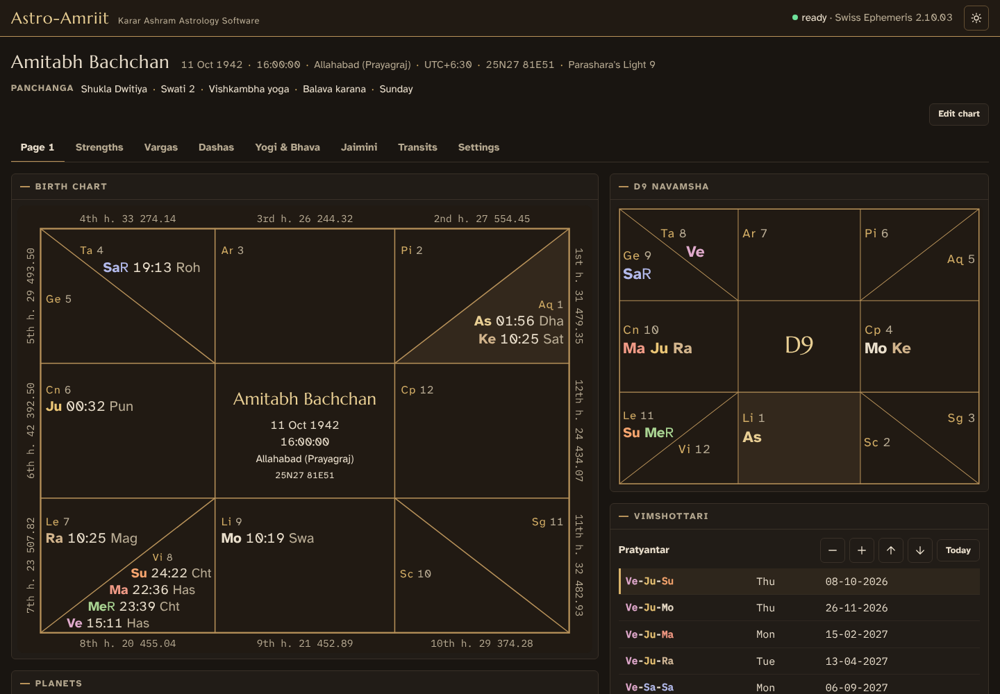

**Text size**: **Normal**, **Large** or **Larger**. This enlarges all text and
tables. The charts grow with the window: make the window larger, or zoom
the browser (Ctrl and +, or Cmd and + on a Mac), to make them bigger.

### On a phone or tablet

The app also works on a phone. The form fields wrap into one or two
columns, the panels sit in one column, the tabs scroll sideways, and the Rasi chart shows
planet names only (the degrees are in the table under it).

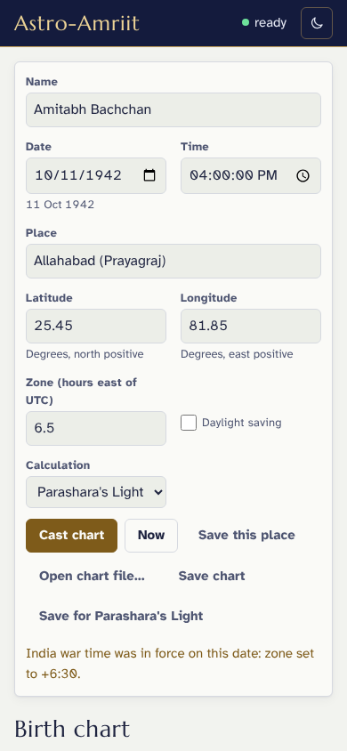
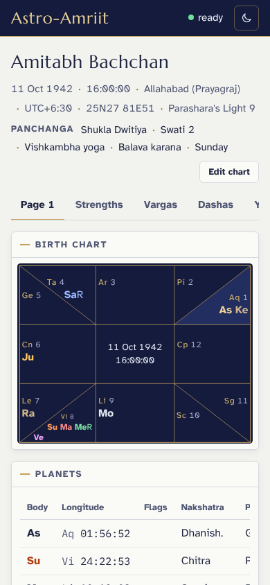

---

## 6. How far can I trust each number?

"Checked against PL" means the app's number was compared with what
Parashara's Light itself printed or showed. Most checks use **one** PL 9
screen (the Page 1 of the example chart). The words in the last column are
exact; nothing here is rounded up.

| What you see | Checked against | Result |
|---|---|---|
| Planet longitudes (PL 9 profile) | PL 9 Page 1 of the example chart | 9 of 9 planets equal to the displayed second |
| Ascendant | Same PL 9 screen | Within 5″ (PL's atlas rounds coordinates to the minute) |
| Retrograde and combust flags | Same PL 9 screen | All bodies match |
| Nakshatra, pada syllable, pada and star / sub / sub-sub lords | Same PL 9 screen | All 10 points match. Spellings and syllables for nakshatras not on that screen come from PL 7's tables; PL 9's own table has not been seen yet |
| D9 signs on Page 1 | Same PL 9 screen | All match |
| Vimshottari dates | Same PL 9 screen | 10 of 10 dates match (with 365.2421875-day years; 365.25 would give 5 of 10) |
| Page 1 strength fields (edge labels, Dignity, SB%, SB#, VB, AV, Av3, Av5, K7, Func.) | Same PL 9 screen: 145 fields | Reproduced by an independent check program with no mismatches, except the open items below. SAV 12 of 12; Bhava Bala 12 of 12 (within half a virupa); SB% 7 of 7 to two decimals |
| **Ketu's VB** | Same PL 9 screen | **Open.** PL shows 14; the app shows 9. Not yet explained |
| Rahu's AV, and the Func. rule for Rahu and Ketu | Same PL 9 screen | The values match on this chart, but the rule PL uses is not certain (one chart cannot decide it) |
| Shad Bala and Bhava Bala components (Strengths page) | The totals feed SB% and Bhava Bala, which match PL 9 | The individual rows have not been compared with PL's own Shad Bala or Bhava Bala tables (no printout yet) |
| Divisional charts (all 31 of PL's vargas) | Rules decoded from PL's program; compared with an exact copy of PL's calculation and with another program (PyJHora) | Decoded and tested. Not yet compared with a PL 9 printout. The names of the alternate vargas are descriptive, not PL's own. D11 "Iyer" is a placeholder |
| A planet exactly on a varga boundary | Our own convention | Belongs to the amsa that begins there. PL may differ only for a point exactly on a boundary |
| Yogi point | Decoded from PL's program; cross-checked with PyJHora | Matches |
| **Avayogi** and **Duplicate Yogi** | — | **Open.** PL's convention not yet confirmed; the Avayogi rule is selectable |
| Panchanga (tithi, nakshatra, yoga, karana) | Cross-checked with PyJHora | Matches. The weekday uses PL's sunrise convention |
| NTP page: Dasha chart, division charts, Mathematical Navamsha | Iyer's own worked examples (NTP-2 Chart 1 Dasha chart; Chart 1 D-chart table; 7 Navamsha examples) | Exact, apart from 3 misprinted cells in the book's D-chart table. The rules themselves are Iyer's; whether they predict well is untested |
| KP page: cusps, lords, houses, significators | House placement compared with Kala Chakra's KP engine on 2 000 random charts (all equal); lords use the Page 1 rule, which matches PL 9; significator definitions from PL 7's manual | Not yet compared with a PL KP printout. Which Krishnamurti ayanamsa PL 9 uses on its KP screen is still to be confirmed (Test 2 of the export procedure) |
| Bhava chalit (Sripati and equal houses) | Cross-checked with PyJHora on over 100 charts | Centres and houses match. Not yet compared with PL |
| Chara karakas (7) | PL 9 Page 1 K7 column | 7 of 7 |
| Pranapada | A PL 7 printout of another public chart | Within 0.05° |
| Other special lagnas, arudha padas, argala, rashi drishti | Cross-checked with PyJHora on many charts | Match, apart from a few known and listed differences (rare arudha cases, and PyJHora's own way of taking the Sun at sunrise). Not yet compared with PL |
| **Arudha exception** (lord in the 7th) | — | **Open.** PL's rule not confirmed; selectable |
| Transits: sign, nakshatra and pada changes, stations | Checked that the planet really crosses the boundary; Moon nakshatras compared with PL 7's own transit records 2020–2048; one Sade Sati compared with published dates | Pass. Not yet compared with a PL 9 transit screen |
| **Delta-T for modern charts** (PL 9 profile) | — | **Open.** For recent dates, PL 9 may use a slightly different Delta-T. This could move the Moon by about 10″. To be checked on PL 9 |
| House cusps between the ascendant and midheaven (PL 9) | — | Placidus is assumed from PL 7; only the ascendant has been confirmed on PL 9 |
| PL 7 profile | PL 7's own transit records, 1392 samples 2020–2048 | Moon within 0.06″, Rahu within 0.76″ |
| Solar Fire / Kala Chakra profile | 10 Solar Fire Gold reference charts | 80 planets within 1″, 120 cusps within 12″ |
| Ayanamsa options | PL 7's program | 7 of 7 values within 0.1″ |
| Opening PL chart files | The family's whole PL collection | Every file opens |
| Works offline | Automatic test with the network switched off | Opens, casts, makes no network requests |

The open items will be settled with a few PL 9 printouts (Shad Bala and
Bhava Bala tables, Vimshopaka, Ashtakavarga, the calculation options
screen). Until then, when a number in an **Open** row matters for a
judgement, check it in PL.

---

## 7. Troubleshooting

**The green "ready" does not appear.**
Wait a few seconds; it normally takes about one second. If a red message
appears that starts *The ephemeris could not start*, then:

1. Close the browser tab and double-click the file again.
2. Try another browser (Chrome, Edge, Firefox or Safari, a recent version).
   Very old browsers cannot run the app.
3. Copy the file again from the original. A file that was only partly
   copied cannot start.

**The planets are off by about an hour of motion (the Moon by about half a
degree).**
The zone is wrong. Open **Edit chart** and check **Zone** and **Daylight
saving**:

- India 1 Sep 1942 – 14 Oct 1945: zone 6.5 (or 5.5 with **Daylight
  saving** ticked). The app does this by itself only for its built-in Indian
  places, not for places you typed or saved.
- For any chart **before 1955**, check what clock the time was written in.
  Some Indian cities kept their own local time in those years (for example
  Bombay time and Calcutta time).
- Abroad, check whether summer time was in force on that date, and tick
  **Daylight saving** if it was.

**The date came out wrong.**
Read the words under the **Date** box (for example *11 Oct 1942*). The box
itself may show month before day.

**My numbers differ from PL's.**

1. Check the profile in the chart line (for example *Parashara's Light 9*).
2. Open **Settings** and look for a **Use the profile value** button. If one
   is there, a setting was changed for all charts.
3. Open **How was this computed?** on Page 1 and compare the ayanamsa and
   Delta-T with PL.
4. Check section 6: the item may be one of the open ones.

**"Strengths could not be computed for this chart."**
The other pages still work. Please report the chart's date, time and place
(not the person's name) so that it can be looked into.

**A PL file will not open.**
If the app says *This is not a Parashara's Light chart file (no
<BirthData>)*, the file is not a PL chart file. Choose the `.xml` file of
the chart itself.

**My saved places or settings have gone.**
They are kept by the browser on that computer. A private window, clearing the
browser's history and data, or using a different browser starts with an
empty list.

**Printing a page.**
Use the browser's own Print command: **Ctrl+P** (Windows) or **Cmd+P** (Mac).

1. Open the page you want to print (for example **Page 1**).
2. Choose **Landscape** for wide tables.
3. Under "More settings", turn on **Background graphics**. Without it the
   chart plate prints without its dark background, and its light lettering
   is hard to read on white paper.
4. The **Light** theme prints most clearly.

---

## 8. Glossary

**Planets and signs**

| Short | Meaning |
|---|---|
| As | Ascendant (lagna) |
| Su Mo Ma Me Ju Ve Sa Ra Ke | Sun, Moon, Mars, Mercury, Jupiter, Venus, Saturn, Rahu, Ketu |
| Ar Ta Ge Cn Le Vi Li Sc Sg Cp Aq Pi | Aries, Taurus, Gemini, Cancer, Leo, Virgo, Libra, Scorpio, Sagittarius, Capricorn, Aquarius, Pisces |
| R | Retrograde |
| c | Combust |
| 25N27 81E51 | Latitude 25°27′ north, longitude 81°51′ east |
| UTC+6:30 | Clock time 6 hours 30 minutes ahead of Greenwich |

**Nakshatras in the Rasi chart (three letters)**

Ash Ashwini · Bha Bharani · Kri Krittika · Roh Rohini · Mrg Mrigasira ·
Ard Ardra · Pun Punarvasu · Pus Pushya · Asl Ashlesha · Mag Magha ·
PPh Poorva Phalguni · UPh Uttara Phalguni · Has Hasta · Cht Chitra ·
Swa Swati · Vis Vishakha · Anu Anuradha · Jye Jyeshtha · Mul Moola ·
PSh Poorvashadha · USh Uttarashadha · Shr Shravana · Dha Dhanishta ·
Sat Shatabhishak · PBh Poorvabhadra · UBh Uttarabhadra · Rev Revati

**Strengths**

| Short | Meaning |
|---|---|
| SAV | Sarvashtakavarga: total bindus of a sign from all seven planets (sum 337) |
| AV | Ashtakavarga bindus of the planet in the sign it occupies |
| SB% | Shad Bala ÷ required Shad Bala (1.00 = exactly the required strength) |
| SB# | Number of strong balas (groups at or above their minimum), 0–5 |
| VB | Vimshopaka bala, out of 20 |
| Av3 | Three-state avastha: Alr. (alert), Drm. (dreaming), Slp. (sleeping) |
| Av5 | Five-state avastha: Infant, Youth., Adoles., Old, Dead |
| Func. | Functional nature for the ascendant: Benefic, Malefic, Neutral |
| Exalt. · Moolt. · Own · Grt.Fr. · Frnd. · Neutr. · Enemy · Grt.En. · Debil. | Dignity: exalted, moolatrikona, own sign, great friend, friend, neutral, enemy, great enemy, debilitated |
| Virupa, rupa | Units of Shad Bala and Bhava Bala; 60 virupas = 1 rupa |

**Karakas and Jaimini**

| Short | Meaning |
|---|---|
| K7 | Chara karaka, 7-karaka scheme |
| AK AmK BK MK PiK PK GK DK | Atma, Amatya, Bhratru, Matru, Pitru, Putra, Gnati, Dara karaka |
| AL, A2 … A11, UL | Arudha lagna (A1), the other arudha padas, upapada (A12) |
| KL | Karakamsha lagna (the AK's navamsha sign) |

**Charts and dashas**

| Short | Meaning |
|---|---|
| D1, D2 … D150 | Divisional charts (vargas): D1 Rashi, D9 Navamsha, D10 Dashamsha, and so on |
| • (in the vargas table) | Vargottama: the same sign as in the Rasi chart |
| BIN · STD · OPEN | Rule decoded from PL's program · textbook rule not yet confirmed · placeholder |
| Maha, Antar, Pratyantar, Sookshma, Prana, Deha | The six levels of Vimshottari dasha |
| Ve-Ju-Su | A period chain: Venus maha, Jupiter antar, Sun pratyantar |
| Sandhi, madhya | Beginning and centre of a bhava |

**Calculation**

| Short | Meaning |
|---|---|
| PL | Parashara's Light (GeoVision) |
| KP | Krishnamurti Paddhati; star / sub / sub-sub lords |
| Ayanamsa | The difference between the tropical and sidereal zodiacs |
| ΔT, Delta-T | The small difference between clock time and astronomical time (seconds) |
| Julian Day (UT) | A running day count used by astronomers to name a moment |
| True node, mean node | Rahu's exact (wobbling) position, or its smoothed average |
| Placidus | The house system PL uses for cusps |
| Profile | A set of calculation choices: Parashara's Light 9, Parashara's Light 7, or Solar Fire / Kala Chakra |
| Swiss Ephemeris | The planetary tables built into the app (© Astrodienst AG) |
